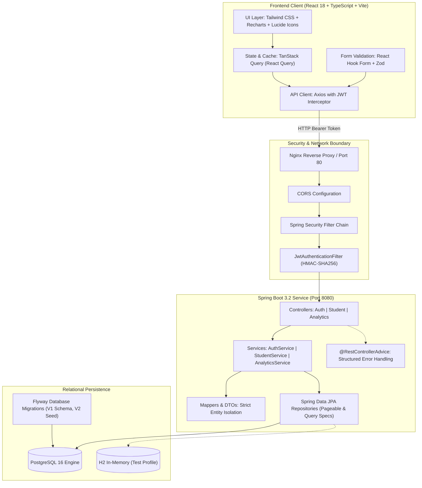

# EduPulse — Full-Stack Student Management & Analytics System

[](https://spring.io/projects/spring-boot)
[](https://www.oracle.com/java/)
[](https://react.dev/)
[](https://www.typescriptlang.org/)
[](https://www.postgresql.org/)
[](https://tailwindcss.com/)
[](https://www.docker.com/)

An enterprise-grade, production-style Full-Stack Student Administration and Real-Time Analytics Dashboard. Built with a decoupled **Spring Boot 3.2 (Java 17)** microservice backend and a modern **React 18 + TypeScript + Tailwind CSS** frontend using **TanStack Query**, **React Hook Form + Zod**, and **Recharts**.

---

## 🏗️ Architecture Overview

The platform uses a layered, cloud-ready architecture:



---

## ✨ Key Features

### 💻 Frontend (React Developer Showcase)
- **Production SaaS UI/UX**: Designed with a sleek, responsive interface supporting both Light and Dark modes.
- **Real-Time Analytics Dashboards**: Interactive charts powered by **Recharts** displaying departmental distributions (Pie chart) and cohort strength (Bar chart).
- **Advanced Data Table**:
  - Live multi-field search (Student Name, Enrollment Number, Email).
  - Dynamic dropdown filtering by academic department and cohort year.
  - Multi-column ascending/descending sorting.
  - Server-side pagination with record count telemetry.
- **Robust Form Engineering**: Type-safe forms built with **React Hook Form** and **Zod** schema validation, with instant client-side feedback and inline backend error mapping.
- **Server Cache & Synchronization**: Implemented via **TanStack Query (v5)** with automatic cache invalidation on create, update, and delete mutations.
- **Role-Based Routing**: Role-guarded route protection (`ADMIN` vs `STAFF`) ensuring fine-grained UI permission boundaries.
- **Zero Raw Layout Shifts**: Smooth skeleton loaders, animated modals, and toast notification alerts.

### 🛡️ Backend Engineering
- **Clean Package Hierarchy**: Unified under `com.neeraj.studentmanagement` with strict separation of concerns (`controller`, `service`, `repository`, `entity`, `dto`, `exception`, `security`, `config`).
- **Stateless JWT Security**: Spring Security filter chain with BCrypt password hashing and cryptographic HMAC-SHA256 token verification.
- **Role-Based Access Control (RBAC)**:
  - `ROLE_ADMIN`: Full CRUD privileges (create, update, delete students, view analytics).
  - `ROLE_STAFF`: Read-only directory access and institutional analytics inspection.
- **Flyway Database Migrations**: Automated versioned SQL migration scripts (`V1__init_schema.sql`, `V2__seed_initial_data.sql`).
- **Jakarta Bean Validation**: Strict payload validation (`@NotBlank`, `@Email`, `@Size`, `@Pattern`) returning RFC-compliant structured error payloads.
- **Grounded Analytics Engine**: Direct database aggregation queries (`GROUP BY` counts) — zero simulated telemetry.
- **OpenAPI 3 / Swagger**: Interactive API documentation with built-in JWT authorization support.

---

## 🛠️ Technology Stack

| Layer | Technologies |
| :--- | :--- |
| **Frontend** | React 18, TypeScript, Vite, Tailwind CSS, TanStack Query v5, React Hook Form, Zod, Recharts, Axios, Lucide React |
| **Backend** | Java 17 (LTS), Spring Boot 3.2.0, Spring Data JPA, Hibernate, Spring Security, JJWT 0.12.5, Flyway |
| **Database** | PostgreSQL 16 (Primary / Production), H2 In-Memory (Testing & local fallback) |
| **Documentation**| Springdoc OpenAPI 3 / Swagger UI |
| **DevOps** | Docker, Docker Compose, Multi-stage builds, Nginx, GitHub Actions CI |

---

## 📁 Repository Directory Structure

```
Student-management/
├── .github/
│   └── workflows/
│       └── ci.yml               # GitHub Actions CI workflow
├── docs/
│   └── IMPLEMENTATION_STATUS.md # Architecture audit and refactoring log
├── docker-compose.yml           # Multi-container orchestration (Postgres, Backend, Frontend)
├── .env.example                 # Environment configuration template
├── frontend/                    # Modern React 18 + TypeScript application
│   ├── src/
│   │   ├── api/                 # Axios HTTP client & API service endpoints
│   │   ├── components/          # Reusable UI primitives, Modals, Layouts
│   │   ├── context/             # AuthContext, ThemeContext, ToastContext
│   │   ├── features/            # Feature modules (StudentTable, StudentForm, Analytics)
│   │   ├── pages/               # Login, Dashboard, Directory, Details, Forms, Analytics
│   │   ├── types/               # TypeScript data models & API contracts
│   │   └── utils/               # Formatting utilities & Tailwind class merger (cn)
│   ├── Dockerfile               # Multi-stage production build (Node -> Nginx)
│   └── nginx.conf               # Nginx reverse proxy configuration
└── student-management/          # Spring Boot 3.2 Maven microservice
    ├── src/main/java/com/neeraj/studentmanagement/
    │   ├── config/              # Security, OpenAPI, DataInitializer
    │   ├── controller/          # Auth, Student, Analytics REST controllers
    │   ├── dto/                 # Request & Response DTO records
    │   ├── entity/              # JPA Entities (Student, User, Role)
    │   ├── exception/           # Custom domain exceptions & GlobalExceptionHandler
    │   ├── mapper/              # Entity-DTO mapping components
    │   ├── repository/          # Spring Data JPA repositories with query specs
    │   ├── security/            # JWT provider, filter, UserPrincipal, UserDetailsService
    │   └── service/             # Business interfaces & implementation classes
    ├── src/main/resources/
    │   ├── application.properties
    │   └── db/migration/        # Flyway schema and initial seed migrations
    ├── src/test/                # Mockito and Spring Boot unit/integration tests
    ├── pom.xml
    └── Dockerfile               # Multi-stage production container build
```

---

## 📡 REST API Specifications

| Method | Endpoint | Access Role | Description |
| :--- | :--- | :--- | :--- |
| `POST` | `/api/auth/login` | Public | Authenticate user & return signed JWT Bearer token |
| `POST` | `/api/auth/register` | Public | Register new staff or administrator account |
| `GET` | `/api/students` | `ADMIN`, `STAFF` | Paginated, sorted, and filtered student list |
| `GET` | `/api/students/{id}` | `ADMIN`, `STAFF` | Fetch specific student profile by ID |
| `POST` | `/api/students` | `ADMIN` only | Create a new student (returns `201 Created`) |
| `PUT` | `/api/students/{id}` | `ADMIN` only | Update an existing student record |
| `DELETE`| `/api/students/{id}` | `ADMIN` only | Permanently delete student record (`204 No Content`) |
| `GET` | `/api/students/search`| `ADMIN`, `STAFF` | Keyword search across name, email, and ID |
| `GET` | `/api/students/filter`| `ADMIN`, `STAFF` | Filter by academic branch and/or year |
| `GET` | `/api/analytics/stats`| `ADMIN`, `STAFF` | Real-time database metrics & department distributions |

---

## 🚀 Getting Started

### Prerequisites
- **Java**: JDK 17 or higher
- **Node.js**: v18 or higher (v20+ recommended)
- **PostgreSQL**: v14+ (or use Docker)

### Option 1: One-Click Docker Setup (Recommended)
Clone the repository and launch the entire multi-service stack with a single command:

```bash
docker-compose up --build
```
- **Frontend Application**: `http://localhost`
- **Backend API**: `http://localhost:8080/api`
- **Swagger Documentation**: `http://localhost:8080/swagger-ui.html`

### Option 2: Running Locally for Development

#### 1. Start the Backend
```bash
cd student-management

# Run with PostgreSQL (or H2 test profile for instant local run)
./mvnw spring-boot:run
```
*Note: A built-in `DataInitializer` seeds default test accounts and sample students on first launch:*
- **Admin Account**: Username: `admin` | Password: `admin123`
- **Staff Account**: Username: `staff` | Password: `staff123`

#### 2. Start the Frontend
```bash
cd frontend

# Install dependencies
npm install

# Start Vite development server
npm run dev
```
Open **`http://localhost:5173`** in your browser.

---

## 🧪 Testing

Execute backend unit tests and context validation:
```bash
cd student-management
./mvnw test
```

Execute frontend typechecking and production build validation:
```bash
cd frontend
npm run build
```

---

## 💼 Interview Explanation & Resume Highlights

### Core Talking Points
1. **Frontend Architecture**: Built with a modular React architecture adhering to the Container/Presenter pattern. Employed **TanStack Query** for asynchronous server-state caching, eliminating redundant network calls and managing pagination effortlessly.
2. **Form Engineering**: Leveraged **React Hook Form** coupled with **Zod** schema resolvers to ensure zero unnecessary component re-renders while strictly enforcing client-side validation that matches the backend's Jakarta Bean Validation rules.
3. **Security & Authorization**: Configured stateless **JWT authentication** with role-based route guards on the React client and Spring Security method-level annotations (`@PreAuthorize`) on the backend.
4. **Relational Database Migrations**: Integrated **Flyway** for deterministic database version control across development and production environments.

